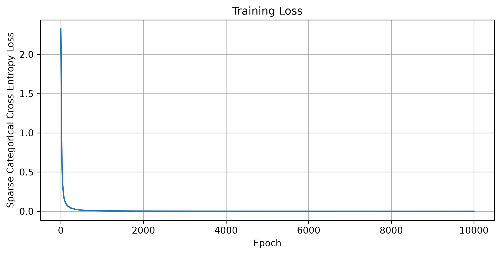
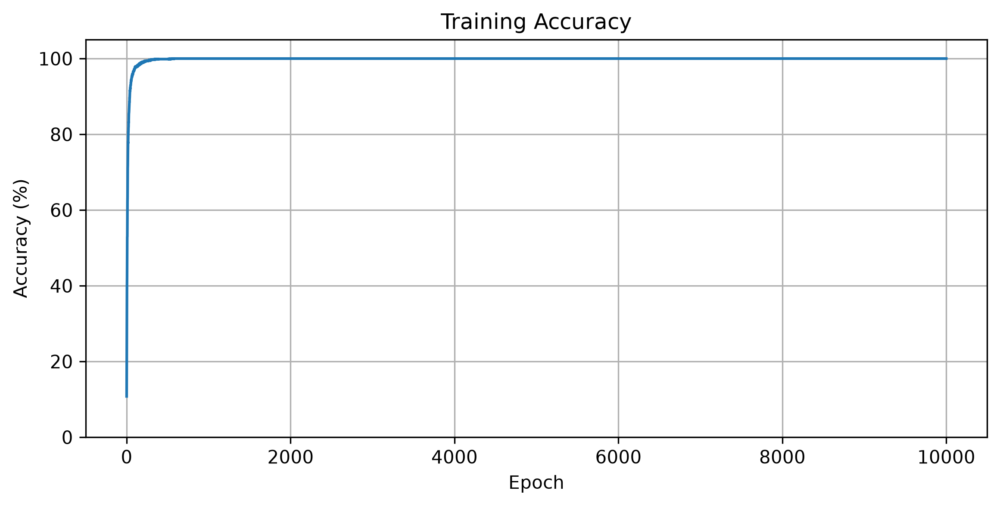
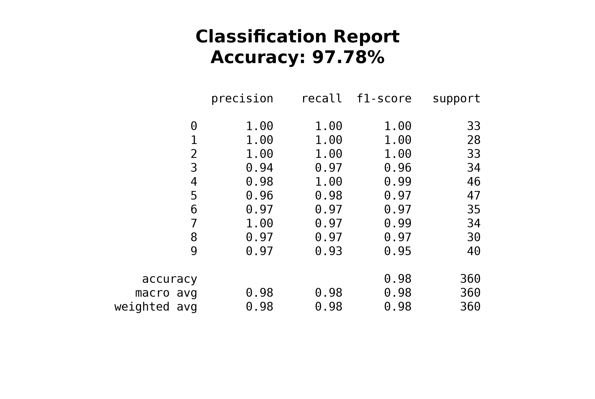
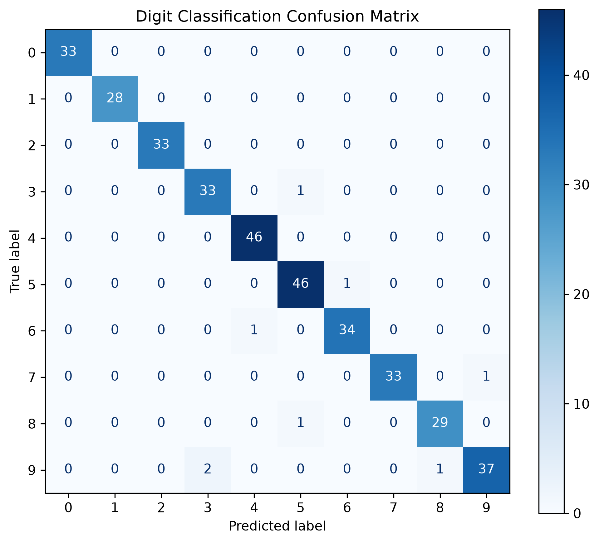

# NumberClassifier

**A handwritten digit classification neural network built from scratch with Python and NumPy.**

NumberClassifier is an educational machine learning project that implements a fully connected neural network to recognize handwritten digits from **0 to 9**. The model is trained with manually implemented forward propagation, backpropagation, and mini-batch gradient descent—without TensorFlow or PyTorch.

## Features

- Feedforward neural network with two hidden layers
- Sigmoid activation in the hidden layers and Softmax in the output layer
- Sparse categorical cross-entropy loss
- Backpropagation and gradient descent implemented with NumPy
- Shuffled mini-batch training with `tqdm` progress tracking
- Training loss and accuracy charts exported as PNG files
- Test-set classification report and confusion matrix
- Predictions for individual images or batches

## Neural Network Architecture

Each input is an **8 × 8** grayscale image flattened into **64 features**. The network has two configurable hidden layers and an output layer with **10 neurons**, one for each digit.

```text
Input image (64 features)
          |
          v
Hidden layer 1 (Sigmoid)
          |
          v
Hidden layer 2 (Sigmoid)
          |
          v
Output layer (10 classes, Softmax)
          |
          v
Predicted digit (0–9)
```

Weights and biases are learned through backpropagation, using the gradients of the cross-entropy loss.

## Dataset

The project uses the [scikit-learn Digits dataset](https://scikit-learn.org/stable/modules/generated/sklearn.datasets.load_digits.html).

| Property | Value |
| --- | --- |
| Samples | 1,797 |
| Image size | 8 × 8 pixels |
| Input features | 64 |
| Classes | 10 (digits 0–9) |
| Original pixel range | 0–16 |
| Input normalization | Divide pixel values by 16 |
| Train/test split | 80% / 20% |

## Training

For each epoch, the dataset is shuffled and divided into mini-batches. For each mini-batch, the model performs a forward pass, computes the loss, calculates gradients through backpropagation, and updates its weights and biases.

The notebook records training loss and accuracy to help visualize learning over time.

## Training Results

### Training Loss



The loss plot tracks sparse categorical cross-entropy during training. A generally decreasing curve indicates that the model is improving its predictions on the training data.

### Training Accuracy



The accuracy plot shows the proportion of correctly classified training images across epochs.

## Model Evaluation

The trained model is evaluated on a held-out test set. This gives a better indication of how it performs on images not used for weight updates.

### Classification Report



The classification report includes **precision**, **recall**, **F1-score**, and **support** for each digit, along with overall accuracy.

### Confusion Matrix



The confusion matrix shows actual versus predicted digits. Entries on the main diagonal are correct classifications; off-diagonal entries indicate errors.

> **Note:** These image links work when `README.md` is in the repository root and the four PNG files exist under `plots/`. Commit the images to GitHub to display them in the rendered README.

## Project Structure

```text
NumberClassifier/
├── core/
│   ├── __init__.py
│   ├── activations.py
│   └── losses.py
├── data/
│   ├── __init__.py
│   └── digits.py
├── visualization/
│   ├── __init__.py
│   ├── training_plots.py
│   └── evaluation_plots.py
├── plots/
│   ├── training_loss.png
│   ├── training_accuracy.png
│   ├── classification_report.png
│   └── confusion_matrix.png
├── number_classifier.py
├── main.ipynb
├── requirements.txt
├── README.md
└── LICENSE
```

## Getting Started

### 1. Clone the repository

```bash
git clone https://github.com/YOUR_USERNAME/NumberClassifier.git
cd NumberClassifier
```

Replace `YOUR_USERNAME` with your GitHub username.

### 2. Create a virtual environment

```bash
python -m venv .venv
```

On Windows PowerShell:

```powershell
.\.venv\Scripts\Activate.ps1
```

On macOS or Linux:

```bash
source .venv/bin/activate
```

### 3. Install dependencies

```bash
python -m pip install -r requirements.txt
```

### 4. Run the notebook

Open `main.ipynb` in VS Code or Jupyter, select the project's virtual environment as the kernel, and run the cells in order to train and evaluate the model.

## Dependencies

The versions below reflect the project's recorded Python environment:

| Package | Version | Usage |
| --- | --- | --- |
| NumPy | 2.5.4 | Arrays, matrix operations, and gradients |
| Matplotlib | 3.11.2 | Training and evaluation visualizations |
| tqdm | 4.70.1 | Training progress bars |
| scikit-learn | 1.9.1 | Dataset loading, splitting, and evaluation metrics |

## Learning Objectives

This project explores neural network fundamentals through direct implementation: matrix multiplication, activation functions, multiclass classification, the chain rule, gradient descent, mini-batch training, and evaluation of unseen data.

## Possible Improvements

- Experiment with ReLU and other activation functions
- Add configurable hidden-layer sizes and architectures
- Implement Momentum or Adam optimizers
- Save and load trained model weights
- Track validation performance and add early stopping
- Compare performance with other classifiers

## License

This project is licensed under the **MIT License**. See the `LICENSE` file for details.
